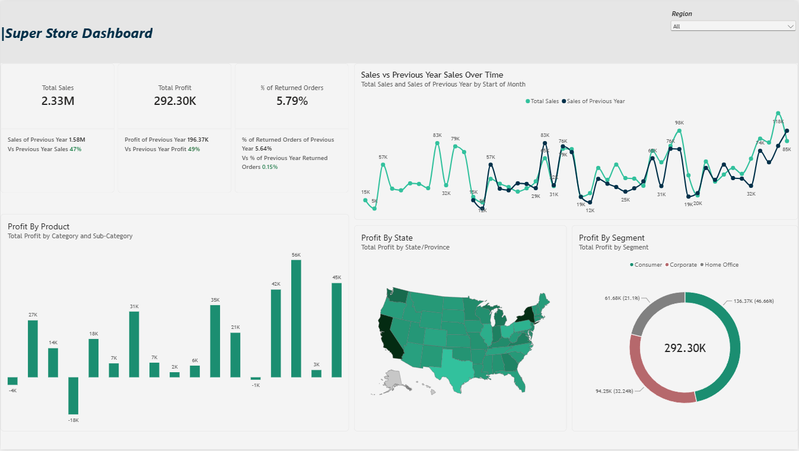

# Superstore Sales Profit Dashboard

## 1. Project Overview

An end-to-end Power BI project built on the Sample Superstore dataset: cleaned and prepared the data, built a Calendar table and data model, created organized DAX measures, and designed an interactive dashboard (cards, charts, map) that answers key business questions about sales, profit, and returns.

**Tech used:** Power BI, Power Query, DAX, Data Modeling.

**Business goal:** Give management a single view of how the business is performing: is it growing, which products lose money, where profit comes from, and which customer segments matter most.

---

## 2. Data Source

| File | Format | Role |
|---|---|---|
| Sample - Superstore.xls | Excel | Orders, Returns and People data used for the dashboard |

---

## 3. Business Questions (Tasks)

1. Show Sales, Profit and % of Returned Orders, with % change vs Previous Year (PY).
2. Compare Sales performance versus Previous Year over time.
3. Determine the most profitable product and the most loss-making product.
4. Find out the place where most of the profit is happening.
5. Show sales by segment.

---

## 4. Data Cleaning (Power Query)

- Applied **Trim** and **Clean** to text columns to remove extra spaces and hidden characters
- Removed unnecessary columns that were not needed for analysis
- Fixed formatting and data types (dates, numbers, text)
- Prepared the Orders and Returns data so returned orders can be calculated correctly

---

## 5. Data Modeling

- Created a **Calendar (Date) table** using the DAX `CALENDAR` function, which is required for previous-year and time-based comparisons
- Marked the Calendar table as the date table and built **relationships** between the Calendar table and the other tables
- Created a separate table named **Analytics** to hold all the measures in one place

---

## 6. DAX Measures

All measures live in the **Analytics** table and are organized into **Display Folders**, so they are easy to find and maintain.

Measures built:

- Total Sales
- Total Profit
- % of Returned Orders
- Sales of Previous Year
- Profit of Previous Year
- % of Returned Orders of Previous Year
- Vs Previous Year (Sales, Profit, Returned Orders)

---

## 7. Dashboard Visuals

| Visual | Purpose |
|---|---|
| KPI Cards | Total Sales, Total Profit, % of Returned Orders, each with the previous-year value and the change vs PY |
| Line Chart | Sales vs Previous Year Sales over time (by start of month) |
| Column Chart | Profit by Category and Sub-Category |
| Filled Map | Profit by State |
| Donut Chart | Profit by Segment |
| Slicer | Region filter for the whole dashboard |

---

## 8. Business Problems Solved

| Question | How the dashboard answers it |
|---|---|
| How is the business doing compared to last year? | KPI cards show Sales, Profit and Returned Orders with % change vs PY |
| Is performance consistent over time? | Line chart compares current vs previous year sales month by month and shows peaks and dips |
| Which products make or lose money? | Profit by Sub-Category highlights the top profit makers and the loss-making products |
| Where is the profit coming from? | Map shows profit by state; California and New York stand out as the darkest |
| Which customer segment matters most? | Segment donut chart shows the share of each segment |
| Is the return rate a concern? | The returned orders card tracks the rate against the previous year |

---

## 9. Key Insights

**Overall performance:**
- Total Sales: **2.33M**
- Total Profit: **292.30K**
- % of Returned Orders: **5.79%** (previous year: 5.64%)

**Product performance:** Most sub-categories are profitable, with the best one reaching about 56K profit. A few sub-categories lose money, the biggest loss being about -18K, so these are candidates for a pricing or discount review.

**Geography:** Profit is concentrated in a few states, with California and New York the strongest.

**Segment:** Consumer contributes the most profit (136.37K, 46.66%), followed by Corporate (94.25K, 32.24%) and Home Office (61.68K, 21.1%).

**Returns:** The returned orders rate is slightly higher than the previous year, so it is worth monitoring.

---

## 10. Project Files

- `assignment.pbix`: Power BI dashboard file
- `Sample - Superstore.xls`: source data
- `assets/dashboard_screenshot.png`: dashboard screenshot

---

## 11. Branding

- **Project name:** Superstore Sales Profit Dashboard
